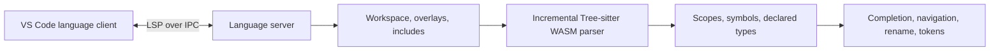

# P4 language support for VS Code

P4_16 editing with a Tree-sitter language server. VS Code 1.96 or newer is required.

## Features

- Completion for visible declarations, nested header/struct members, extern methods, header stacks, and built-in methods. Member completion also works after a trailing dot in incomplete code.
- Go to definition and type definition, including declarations in included files and navigation from an include directive.
- Hover documentation, signature help, document outlines, workspace symbols, and folding.
- References and rename across workspace P4 files, respecting lexical scopes and shadowed names. Rename validates identifiers, rejects known name collisions, and produces versioned edits for open documents.
- Semantic highlighting layered over the existing TextMate grammar.
- Syntax, missing-include, and preprocessor diagnostics while editing.

Unsaved files and unsaved include changes participate in analysis. P4 source locations use UTF-16 positions, including files containing Unicode or CRLF line endings.

## Configuration

The extension starts automatically when a P4 file opens. For project-specific headers and conditional compilation, add workspace settings:

```json
{
  "p4.includePaths": ["include", "/opt/p4c/p4include"],
  "p4.defines": { "V1MODEL_VERSION": "20200408" },
  "p4.maxNumberOfProblems": 100,
  "p4.trace.server": "off"
}
```

Include paths are relative to the containing workspace folder unless absolute. Quoted includes search the including file's directory first. Both quoted and angle includes then search configured directories, the workspace folder, and the bundled headers. Resource settings support projects in different workspace folders.

Bundled headers are `core.p4`, `v1model.p4`, the **BMv2 variant** of `psa.p4`, and portable `pna.p4`. Their pinned upstream revision and checksums are recorded in [p4include/sources.json](p4include/sources.json). Configure your compiler's header directory to use the exact architecture and version for your target.

`p4.trace.server` accepts `off`, `messages`, or `verbose`. The P4 Language Server output channel contains server logs and protocol traces.

## Analysis scope

The grammar targets P4_16, with selected newer syntax such as `for` loops. The current working specification and released v1.2.5 specification are stored in [docs/](docs/); [docs/sources.json](docs/sources.json) records their sources and checksums. P4_14 is outside the supported scope.

The semantic model resolves declarations, lexical scopes, includes, explicit types, generic type arguments, aliases, enums, parser states, and common built-in members. Diagnostics cover parsing and preprocessing; this server does **not** implement the compiler's complete type system, overload selection, implicit generic inference, target checks, or execution semantics. Continue using `p4c` for compiler validation. Arbitrary vendor extensions and full coverage of working-draft syntax are not guaranteed.

Preprocessing follows includes in source order, handles include guards and active `#pragma once`, selects `#if`/`#ifdef`/`#ifndef`/`#elif`/`#else` branches, and tracks `#define`/`#undef`. Numeric `#if` expressions support object-macro expansion, `defined`, arithmetic, comparisons, and logical operators. Function macros in conditions, ternary conditions, and compiler-specific directives require a full preprocessor. Bitwise operations currently use 32-bit integers. **Macros are not expanded in P4 program tokens**, so macros that generate declarations or substitute type names can limit parsing and navigation. Macro definitions have hover and navigation support; macro rename is disabled.

References, semantic tokens, and rename use active code under the configured definitions. Inactive branches are excluded. Workspace searches scan `.p4` files and open documents, excluding hidden directories, `node_modules`, `dist`, `out`, `build`, and `vendor`; includes reached from scanned files still participate. Overloaded or multiply declared symbols and bundled library symbols cannot be renamed. Workspace scanning has explicit size/depth limits and reports an error if they are reached, instead of returning a partial rename. Complex expressions may offer fewer completion suggestions.

## Architecture and migration



The old generated ANTLR code and visitor-based extension implementation have been replaced. `src/main.ts` handles client startup; `src/server/server.ts` owns the LSP lifecycle. Parsing, preprocessing, workspace management, symbol/type resolution, and editor features live in separate server modules. The same server supports other editors through stdio.

The migration proceeds through local checkpoints: specifications and provenance; client/server build; parser replacement; scope/type/include model; editor features and protocol tests; then packaging and development documentation. TextMate highlighting remains available while the server starts.

Each translation unit preprocesses its own include graph and keeps source coordinates in the original files. Tree-sitter reuses edited trees; changes confined to masked directives or inactive code can preserve the existing tree. Idle translation-unit caches are bounded, and include edits invalidate dependent units. Workspace references parse additional files on demand. Rename requests reject concurrent document changes.

## Development

Use Node.js **22.17 or newer** and npm. The development tests use Node's `--test-isolation=none` flag; the extension bundles target Node 20 for VS Code compatibility.

```sh
npm ci
npm test
npm run lint
npm run package -- --out /tmp/p4-lang-0.1.0.vsix
```

`npm test` builds the distributable bundles, compiles test imports, and runs parser, preprocessing, semantic, workspace, feature, and real LSP protocol tests. Protocol tests launch child servers and require working child-process stdin/stdout pipes.

Press **F5** to launch an Extension Development Host after the configured build task. `npm run watch` rebuilds bundles during development; restart the Extension Development Host to load changes. `npm run check-types` runs TypeScript validation independently.

Normal builds use the checked-in parser WASM and do not run a native compiler or the Tree-sitter CLI. If changing `grammar/grammar.js`, regenerate it before testing:

```sh
npm run gen:parser
npm test
```

Parser regeneration uses the pinned Tree-sitter CLI. On its first WASM build, the CLI may download its WASI SDK and Binaryen toolchain; subsequent builds use the cache. Generated C source is excluded from Git, while the grammar, license, and compiled WASM are tracked.

To use the bundled server with another LSP client:

```sh
npm run build
node dist/server.js --stdio
```

The VSIX contains the bundled client/server, both WASM assets, standard headers, grammar source, and third-party licenses. No compiler installation, native Node addon, or runtime package download is required. Build scripts emit `dist/THIRD_PARTY_LICENSES.txt` from the actual bundled dependencies.

## Licenses

The extension code is Apache-2.0; see [LICENSE](LICENSE). The modified Tree-sitter grammar derives from [oxidecomputer/tree-sitter-p4](https://github.com/oxidecomputer/tree-sitter-p4) and is MPL-2.0; see [grammar/NOTICE](grammar/NOTICE) and [grammar/LICENSE](grammar/LICENSE). Grammar source is distributed with the extension. Standard headers retain their upstream notices and [Apache-2.0 license](p4include/LICENSE). Bundled JavaScript and the Tree-sitter runtime have their respective licenses in `dist/THIRD_PARTY_LICENSES.txt`.
