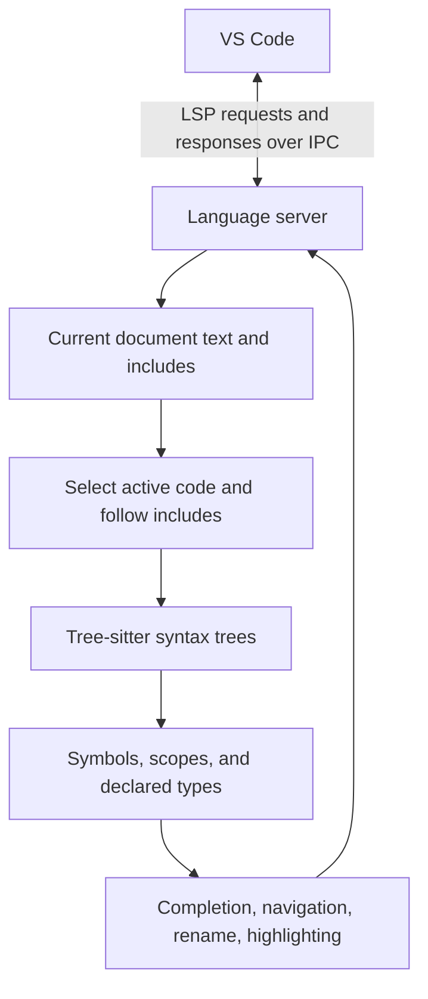
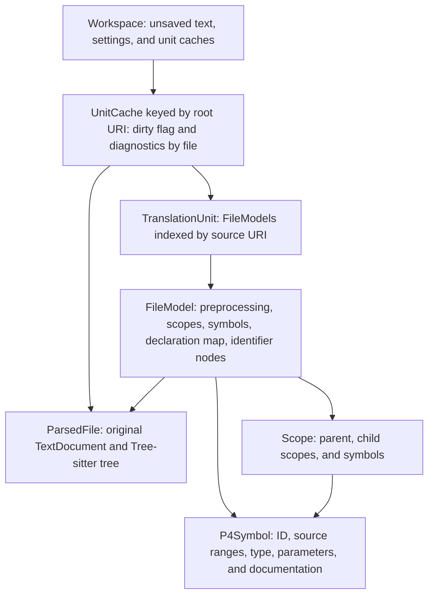
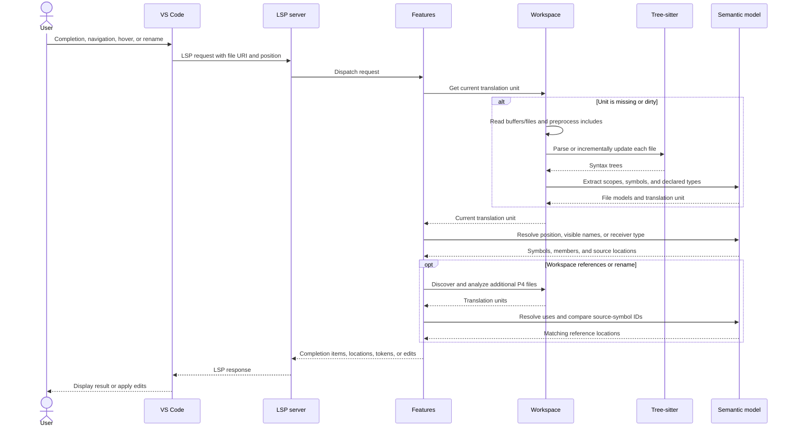

<!--
SPDX-FileCopyrightText: 2026 Zhanghan Wang
SPDX-License-Identifier: Apache-2.0
-->

# P4 language support for VS Code

<p align="left">
    <a href="LICENSE">
        
    </a>
</p>

P4_16 editing with a Tree-sitter language server. VS Code 1.96 or newer is required.

> **Experimental, vibe-coded project:** The language server refactor was developed with substantial AI assistance. Bugs and incomplete language support are possible. Review rename edits and validate your programs with `p4c`.

**The latest version before the refactor is `0.0.14`.** The current code is version `1.0.0`, described below.

## Features

- Completion for visible declarations, nested header/struct members, extern methods, header stacks, and built-in methods. Member completion also works after a trailing dot in incomplete code.
- Go to definition and type definition, including declarations in included files and navigation from an include directive.
- Hover documentation, signature help, document outlines, workspace symbols, and folding.
- References and rename across workspace P4 files, respecting lexical scopes and shadowed names. Rename validates identifiers, rejects known name collisions, and produces versioned edits for open documents.
- Semantic highlighting layered over the existing TextMate grammar.
- Syntax, missing-include, and preprocessor diagnostics while editing.

Unsaved files and unsaved include changes participate in analysis. P4 source locations use UTF-16 positions, including files containing Unicode or CRLF line endings.

## Configuration

The extension starts automatically when a P4 file opens. For project-specific headers and conditional compilation, add workspace settings:

```json
{
  "p4.includePaths": ["include", "/opt/p4c/p4include"],
  "p4.defines": { "V1MODEL_VERSION": "20200408" },
  "p4.maxNumberOfProblems": 100,
  "p4.trace.server": "off"
}
```

Include paths are relative to the containing workspace folder unless absolute. Quoted includes search the including file's directory first. Both quoted and angle includes then search configured directories, the workspace folder, and the bundled headers. Resource settings support projects in different workspace folders.

Bundled headers are `core.p4`, `v1model.p4`, the **BMv2 variant** of `psa.p4`, and portable `pna.p4`. Their pinned upstream revision and checksums are recorded in [p4include/sources.json](p4include/sources.json). Configure your compiler's header directory to use the exact architecture and version for your target.

`p4.trace.server` accepts `off`, `messages`, or `verbose`. The P4 Language Server output channel contains server logs and protocol traces.

## Analysis scope

The grammar targets P4_16, with selected newer syntax such as `for` loops. The current working specification and released v1.2.5 specification are stored in [docs/](docs/); [docs/sources.json](docs/sources.json) records their sources and checksums. P4_14 is outside the supported scope.

The semantic model resolves declarations, lexical scopes, includes, explicit types, generic type arguments, aliases, enums, parser states, and common built-in members. Diagnostics cover parsing and preprocessing; this server does **not** implement the compiler's complete type system, overload selection, implicit generic inference, target checks, or execution semantics. Continue using `p4c` for compiler validation. Arbitrary vendor extensions and full coverage of working-draft syntax are not guaranteed.

Preprocessing follows includes in source order, handles include guards and active `#pragma once`, selects `#if`/`#ifdef`/`#ifndef`/`#elif`/`#else` branches, and tracks `#define`/`#undef`. Numeric `#if` expressions support object-macro expansion, `defined`, arithmetic, comparisons, and logical operators. Function macros in conditions, ternary conditions, and compiler-specific directives require a full preprocessor. Bitwise operations currently use 32-bit integers. **Macros are not expanded in P4 program tokens**, so macros that generate declarations or substitute type names can limit parsing and navigation. Macro definitions have hover and navigation support; macro rename is disabled.

References, semantic tokens, and rename use active code under the configured definitions. Inactive branches are excluded. Workspace searches scan `.p4` files and open documents, excluding hidden directories, `node_modules`, `dist`, `out`, `build`, and `vendor`; includes reached from scanned files still participate. Overloaded or multiply declared symbols and bundled library symbols cannot be renamed. Workspace scanning has explicit size/depth limits and reports an error if they are reached, instead of returning a partial rename. Complex expressions may offer fewer completion suggestions.

## How the language server works



1. **Start and negotiate features.** [src/main.ts](src/main.ts) starts a separate server process and connects over IPC. [src/server/server.ts](src/server/server.ts) advertises the supported LSP capabilities, synchronizes documents, and dispatches requests. TextMate provides basic syntax highlighting immediately. Other editors can connect to the same server over stdio.
2. **Maintain the current source.** [workspace.ts](src/server/workspace.ts) keeps unsaved text in memory, reads other files from disk, and tracks include paths, preprocessor definitions, workspace folders, and file changes. Open buffers take precedence over disk contents.
3. **Preprocess each translation unit.** [preprocessor.ts](src/server/preprocessor.ts) follows includes in source order and selects active conditional branches. It masks directives and inactive code with whitespace while preserving UTF-16 offsets and line endings. Each included file retains its own URI and source coordinates.
4. **Parse active source.** [parser.ts](src/server/parser.ts) loads the generic Tree-sitter runtime and the P4 grammar as separate WASM assets. It creates a concrete syntax tree for each file, retaining error nodes so incomplete input can still provide useful declarations and completion.
5. **Build the semantic model.** [model.ts](src/server/model.ts) extracts declarations, lexical scopes, fields, methods, parameters, and declared types. Its resolver connects identifier uses to declarations and follows types to discover members.
6. **Answer editor requests.** [features.ts](src/server/features.ts) queries the model and produces standard LSP results. VS Code displays completion menus, jumps to source locations, renders semantic tokens, or applies returned rename edits.

For example:

```p4
header Ethernet {
    bit<48> dst;
}

control Ingress(inout Ethernet eth) {
    apply {
        eth.dst = 0;
    }
}
```

Typing `eth.` makes the resolver find the parameter `eth`, follow its declared type `Ethernet`, and return that header's members. Go to definition on `dst` returns the field declaration's source location. Rename collects uses resolving to the same field declaration; an unrelated field also named `dst` stays untouched.

### Information held in memory



The `TextDocument` holds original text and converts offsets to LSP line/character positions. A file's declaration map connects each declaration-name offset to its symbol. Its scope tree supplies lexical visibility, while identifier nodes let the resolver examine uses. Source-symbol IDs combine the file URI and declaration-name offset, allowing references in different files to be compared within the current source state.

`TypeRef` records a type name, generic arguments, and whether it is a stack. Member lookup follows aliases and declared types and substitutes explicit generic arguments. Built-in header, stack, and table members are synthesized when queried. Each translation unit has its own include/preprocessor context, so the same header can be analyzed under different definitions.

On an edit, the server marks affected translation units dirty. Tree-sitter adjusts the previous tree and reuses unchanged portions; the semantic model is rebuilt for affected files. **Parsing is incremental; semantic-model extraction currently rebuilds.** Changes confined to masked text can preserve the existing tree. Include edits invalidate dependent units, and diagnostics are published after a short debounce. Idle unit caches are bounded to 32 entries, while units for open documents are retained.

### From an editor action to a result



| Editor action | How the server produces the result |
| --- | --- |
| Completion | Collect visible declarations or resolve the expression before a dot and list its type's members. A recovery path handles trailing dots in incomplete code. |
| Definition / type definition | Resolve the identifier to a declaration, or follow its declared type, and return the original source range. Include directives navigate to their target files. |
| Hover | Resolve the symbol and return its declaration detail and documentation. |
| Signature help | Find the surrounding call, resolve its function or method, and return parameter information with the active argument. |
| References | Resolve the selected declaration, scan active identifier nodes across workspace translation units, and collect uses with the same symbol ID. |
| Rename | Validate the symbol and new name, find references, check known collisions and concurrent changes, and return versioned edits for VS Code to apply. |
| Document / workspace symbols | Read declaration records and their hierarchy; workspace search analyzes additional files on demand. |
| Semantic highlighting | Resolve identifiers, classify their symbol kinds and modifiers, and encode the ranges as LSP semantic tokens. |
| Folding | Read multiline comment and brace ranges from the syntax tree. |
| Diagnostics | Collect syntax errors, missing includes, and preprocessor issues after opening or changing documents, then publish them to VS Code. |

## Examples

[examples/tutorials/](examples/tutorials/) contains complete P4_16 solutions from [p4lang/tutorials](https://github.com/p4lang/tutorials), pinned at revision `b935e466363679495929e6827b12dd74de27e2dd`.

| Example | What to explore |
| --- | --- |
| [Basic forwarding](examples/tutorials/basic/basic.p4) | Ethernet/IPv4 parsing, routing tables, and packet rewriting |
| [Tunneling](examples/tutorials/basic_tunnel/basic_tunnel.p4) | Custom headers and tunnel forwarding |
| [Calculator](examples/tutorials/calc/calc.p4) | A custom protocol and arithmetic actions |
| [ECN](examples/tutorials/ecn/ecn.p4) | Queue metadata and congestion marking |
| [Firewall](examples/tutorials/firewall/firewall.p4) | Registers, hashing, and a stateful Bloom filter |
| [Flow cache](examples/tutorials/flowcache/flowcache.p4) | Cached forwarding tables and controller packet I/O |
| [Link monitoring](examples/tutorials/link_monitor/link_monitor.p4) | Probe packets, counters, and header stacks |
| [Load balancing](examples/tutorials/load_balance/load_balance.p4) | Hashing and equal-cost multipath forwarding |
| [In-band telemetry](examples/tutorials/mri/mri.p4) | Collecting switch information in packet headers |
| [Multicast](examples/tutorials/multicast/multicast.p4) | Multicast groups and packet replication |
| [QoS](examples/tutorials/qos/qos.p4) | Traffic classification and differentiated-services marking |
| [Source routing](examples/tutorials/source_routing/source_routing.p4) | Header stacks and parser loops |

The imported files retain their upstream copyright notices and [Apache-2.0 license](examples/tutorials/LICENSES/Apache-2.0.txt) unchanged; [sources.json](examples/tutorials/sources.json) records their original paths and checksums. These are source examples for editing and study. They all use `core.p4` and `v1model.p4`, which the server also bundles in [p4include/](p4include/). Use the upstream tutorial's [exercise instructions and runtime setup](https://github.com/p4lang/tutorials/tree/b935e466363679495929e6827b12dd74de27e2dd/exercises) to run them.

[examples/test.p4](examples/test.p4) and the architecture/header fixtures also provide parser regression coverage. The server's pinned fallback headers are maintained separately in [p4include/](p4include/).

## Development

Use Node.js **22.17 or newer** and npm. The development tests use Node's `--test-isolation=none` flag; the extension bundles target Node 20 for VS Code compatibility.

```sh
npm ci
npm test
npm run lint
npm run package -- --out /tmp/p4-lang-1.0.0.vsix
```

`npm test` builds the distributable bundles, compiles test imports, and runs parser, preprocessing, semantic, workspace, feature, and real LSP protocol tests. Protocol tests launch child servers and require working child-process stdin/stdout pipes.

Press **F5** to build and launch an Extension Development Host with the [examples/](examples/) folder open. `npm run watch` rebuilds bundles during development; restart the Extension Development Host to load changes. `npm run check-types` runs TypeScript validation independently.

Normal builds use the checked-in parser WASM and do not run a native compiler or the Tree-sitter CLI. If changing `grammar/grammar.js`, regenerate it before testing:

```sh
npm run gen:parser
npm test
```

Parser regeneration uses the pinned Tree-sitter CLI. On its first WASM build, the CLI may download its WASI SDK and Binaryen toolchain; subsequent builds use the cache. Generated C source is excluded from Git, while the grammar, license, and compiled WASM are tracked.

To use the bundled server with another LSP client:

```sh
npm run build
node dist/server.js --stdio
```

The VSIX contains the bundled client/server, both WASM assets, standard headers, and grammar source. No compiler installation, native Node addon, or runtime package download is required.
